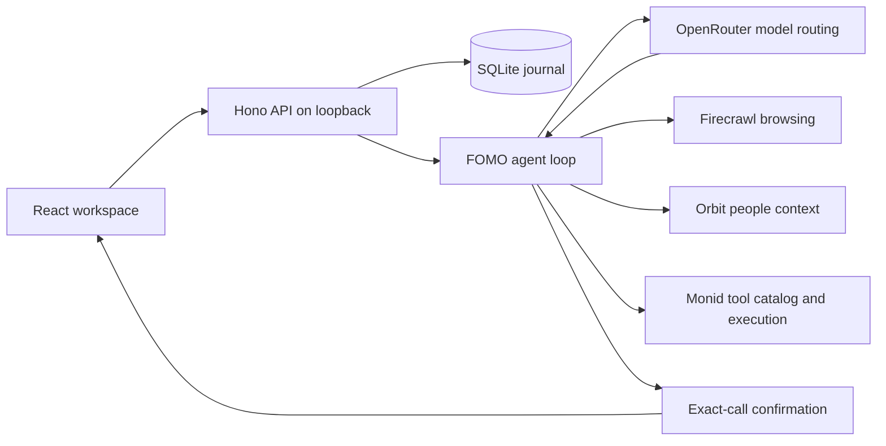

# Architecture

FOMO owns its agent runtime, provider adapters, conversation journal, and research workspace.

`server/agent.ts` owns turn limits, model/tool message ordering, event streaming into the durable journal, confirmations, and cancellation. The client follows event cursors; reloading reconnects to the same in-flight turn. A stable client message UUID deduplicates an uncertain submission.

`server/tools.ts` is the typed registry. The same Zod schemas produce model-visible JSON schemas and enforce actual inputs. Unconfigured providers do not appear in the model’s tool list. Monid’s inspected composite schemas are validated with Ajv before execution.

Provider adapters own HTTP contracts. Requests have bounded timeouts, response limits, and disabled redirects. Firecrawl browser actions are generated from typed primitives; the model cannot execute arbitrary code on the host or in the sandbox. The model never receives API keys, CDP connection URLs, or browser screenshot bytes.

`server/store.ts` is the single-operator journal. Session deletion cascades through messages, events, artifacts, approvals, and operation receipts after browser cleanup succeeds. Recovery marks interrupted work and repairs unanswered tool calls. It retains uncertain operation receipts to prevent automatic duplicate charges.

The client displays Markdown without raw HTML or remote Markdown images. Source links are restricted to credential-free HTTPS. Provider-created screenshots are shown as evidence; the user opens the original source page to interact with it.

## Important limits

- This is a local, single-operator application. Public hosting and multiple users need a separate ownership, authentication, authorization, and persistence design.
- Confirmation is an application control, not a guarantee that a model correctly understands a task. Read exact arguments before approval.
- Firecrawl browser sessions expire. FOMO never reconnects to an expired browser while pretending it retained the previous state.
- A local Stop cannot prove that an uncertain remote submission stopped. Check its authoritative provider receipt.
- A configured key is not evidence of connectivity; live results establish that.
- FOMO does not provide payment execution, messaging channels, personal-vault autofill, shell access, or arbitrary host code execution.
